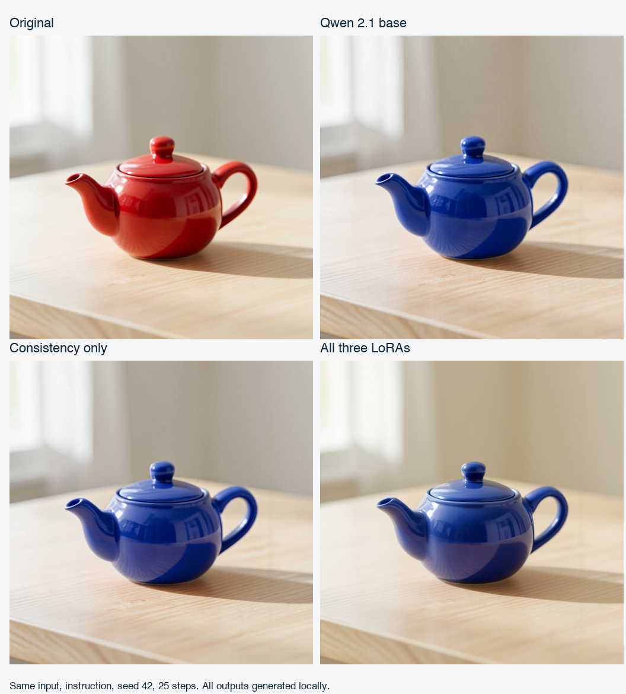

# Local Image Editing with Qwen Image 2.1

A reproducible, local ComfyUI setup for instruction-based image edits on Apple Silicon. Includes a base workflow, a Consistency LoRA workflow, the three-LoRA stack from a community example, and a two-image reference workflow.

This is a practical experiment with measured results, not a promise of ChatGPT-equivalent editing. No paid inference API is needed for the included workflows. Hardware, electricity, storage and time still have a cost.



## What worked

We installed and tested this on an **Apple M5 Pro with 48 GiB unified memory, macOS 26.7.1**, using **ComfyUI 0.42.0, PyTorch 2.14.1 and Python 3.14.8**. The model runs through PyTorch's Apple MPS backend; this is not an LM Studio or MLX workflow.

- A local teapot recolor completed with the base model and with Consistency, largely preserving the original structure.
- The three-LoRA stack ran successfully, but changed the scene's lighting and background more on that sample.
- A cartoon-to-photo test remained stylized even with all three adapters. The Reddit example's apparent realism was not reproduced.
- Successful edits at 512 × 512 took roughly **57–61 seconds**, including loading and saving. These are small-sample measurements, not general performance guarantees.
- A subsequent user test successfully changed a car's DRLs from amber to white. No personal car or human photos are included here.

Full results and the memory-loading recovery are in [Test results](docs/results.md).

## Requirements

- Apple Silicon Mac. **48 GiB is the tested capacity**, not a proven minimum.
- macOS 26.7.1 was tested; other versions and chips are unverified.
- Python **3.14**; the supplied dependency lock was tested with 3.14.8. Use a trusted Python distribution. The installer does not replace system Python.
- Git, curl and the Apple command-line developer tools.
- Allow **at least 60 GB free disk space** for the runtime, approximately 33 GB of model files, and working space. Do not download the entire upstream model repository: it contains multiple variants.
- Internet access for installation/model downloads; generation runs locally afterward.

Unload other large models in LM Studio before inference. We unloaded an idle coding Qwen model without deleting its files or changing its saved configuration. Do not run the coding and image models concurrently on the tested machine.

## Install

Read [Third-party models and licenses](THIRD_PARTY.md) before downloading. **Qwen Image 2.1 uses the Qwen Research License, not Apache 2.0.** This setup was used for personal evaluation. This repository's MIT license covers its original helper code and documentation, not the model weights or ComfyUI.

```bash
git clone https://github.com/kiranrbharadwaj/LocalImage_Setup.git
cd LocalImage_Setup
python3.14 scripts/setup.py
```

The installer checks out a pinned ComfyUI revision inside `.runtime/ComfyUI`, creates a dedicated virtual environment, installs the dependency lock, and copies the workflows and synthetic examples. It does not install custom nodes, a cloud integration, or a system service.

Download the base model, encoder, VAE and Consistency adapter:

```bash
python3.14 scripts/models.py
```

To reproduce the **three-LoRA** setup as well:

```bash
python3.14 scripts/models.py --include-character-loras
```

That option also downloads **Anything2RealCharacters** and **TheseAlpacas V2**. The latter is explicitly NSFW-labeled by its distributor. Neither is needed for an ordinary car-light recolor. The source, exact revision, expected size and SHA-256 of every file are recorded in [models.json](models.json). Downloads resume through `.part` files and are verified before being made available.

Verify an existing installation without downloading anything:

```bash
python3.14 scripts/models.py --include-character-loras --verify-only
```

## Start

```bash
./Start-ComfyUI.command
```

Or double-click `Start-ComfyUI.command` in Finder. If macOS blocks it, use Terminal; do not weaken Gatekeeper or other system security settings. Open **http://127.0.0.1:8188**. No account or login is needed. Stop the server with **Control-C** in its terminal. The launcher does not terminate another process if port 8188 is occupied.

The tested launch settings are intentional:

```text
--listen 127.0.0.1 --port 8188 --offline
--disable-all-custom-nodes --disable-metadata --reserve-vram 8
--bf16-text-enc --cache-none --fast-disk --preview-method none
```

The first default-loading attempt caused heavy swapping. Matching BF16 encoder precision, disabling intermediate caching, and enabling disk-backed loading resolved that issue in our successful small-image tests. Do not assume a smaller weight file, FP8, or an NVIDIA tutorial will work unchanged on Apple Silicon.

## Choose the correct workflow

In the left sidebar, hover over the icons and select **Workflows**—the connected-boxes icon directly below **Model Library**. The panel heading must say **Workflows**, not Model Library. Double-click a saved workflow. If needed, refresh that panel or open a `*-workflow.json` file from this repository.

| Workflow | Purpose | Additional character adapters needed? |
|---|---|---|
| `base-workflow.json` | Baseline instruction-based editing | No |
| `consistency-workflow.json` | Local edits with reduced drift | No |
| `three-loras-workflow.json` | Experimental community-inspired stack | Yes |
| `portrait-base-workflow.json` | Synthetic character conversion baseline | No |
| `portrait-three-loras-workflow.json` | Same conversion with all three adapters | Yes |
| `reference-edit-workflow.json` | Target photo plus appearance/reference photo | No |

The matching `*-api.json` files are for programmatic requests. Use `*-workflow.json` for the visual editor. Do not use ComfyUI's default **Unsaved Workflow** generation graph for these edits.

### Example: change a car's DRLs

1. Open **consistency-workflow**. Close the sidebar and use **Fit View** (or `.` with the canvas focused) to see all nodes.
2. In **Load Image**, click **choose file to upload** and select the photo. This copies it into the local ComfyUI input folder.
3. Replace the teapot instruction in **Text Encode Qwen Image 2.1**, for example:

   > Change only the illuminated amber daytime running light strips inside both front headlamp housings to white. Preserve their exact shape and position. Keep the headlamp housings, car paint, reflections, wheels and background unchanged.

4. Begin with **resolution 512**, **25 steps**, **CFG 1**, **Euler**, **simple** and **seed 42**. The resolution control targets approximately 512 × 512 pixels while retaining aspect ratio; dimensions are rounded to multiples of 32.
5. Click **Run**. Inspect **Save Image** and save the result. Check untargeted regions too.

The workflow uses an empty target latent plus reference conditioning; retain sampler denoise **1.0**. This is not a conventional low-denoise img2img recipe. A mask-guided workflow can help when the model repeatedly changes the wrong region, but no tested mask-compositing workflow is included here.

### Human photos and reusable references

Open **reference-edit-workflow**. `image_1` is the target; `image_2` is the reference. Keep each role explicit in the prompt:

> Edit `<image1>`. Use `<image2>` as the reference for the person's appearance. Change only the jacket to navy blue. Preserve the face, expression, hair, pose, skin tone, background and framing of `<image1>`.

This is reference conditioning, **not training or permanent memory**. Save a named workflow and retain the reference files locally to reuse them. Facial identity is not guaranteed, and Consistency can resist requested pose changes. See [Reference editing guide](docs/reference-editing.md).

## Privacy, storage and limits

The launcher restricts the server to localhost and wraps it in a process-level sandbox allowing loopback networking but denying external networking. It also enables ComfyUI offline mode, disables cloud partner/custom nodes, disables output prompt metadata and sets Hugging Face offline/telemetry flags. An external connection attempt was verified to fail during setup.

These controls apply to the launched ComfyUI process; they are not an audit of every application on the Mac. Model downloads still contact GitHub, PyPI and Hugging Face during installation. See [Privacy and troubleshooting](docs/privacy-and-troubleshooting.md).

Personal inputs, outputs, caches and models remain inside ignored `.runtime/`. **Do not commit your own reference photos, workflows containing sensitive prompts, outputs, logs, or model weights.** Included examples are synthetic. Nothing uploads a test image to GitHub or an inference provider.

## Validate this repository

```bash
python3.14 -m unittest discover -s tests -v
```

CI checks workflow connections, filenames, model pinning, checksum handling, and privacy-critical launch flags without downloading weights or using a GPU. It does not validate image quality or performance on other machines.

For a bounded local smoke test after starting ComfyUI:

```bash
python3.14 scripts/smoke_test.py --workflow consistency
```

That uses the synthetic teapot, monitors **new** swap-outs, and requests interruption if new swap-outs exceed 1 GiB or elapsed time exceeds 20 minutes. The ordinary GUI Run button does not use that guard. Read its limitations in the troubleshooting guide.

## Sources and contributions

- [Official Qwen Image 2.1](https://huggingface.co/Qwen/Qwen-Image-2.1)
- [Official ComfyUI](https://github.com/Comfy-Org/ComfyUI)
- [ComfyUI Qwen 2.1 instructions](https://github.com/Comfy-Org/docs/blob/main/tutorials/image/qwen/qwen-image-2-1.mdx)
- [Community post that inspired the three-adapter test](https://www.reddit.com/r/Qwen_AI/comments/1xdcfnn/qwen_image_21_is_nuts/)

The author did not publish exact LoRA strengths, precision, seed or sampling settings. Our strengths—Anything2Real **0.7**, TheseAlpacas **0.8**, Consistency **1.0**—are experimental starting values, not an exact reproduction.

Try it with synthetic or permissioned images, share reproducible findings, and open an issue or PR. Please include hardware, versions, image dimensions and sanitized settings; never include personal photos without permission. See [Contributing](CONTRIBUTING.md) and [Security](SECURITY.md).
