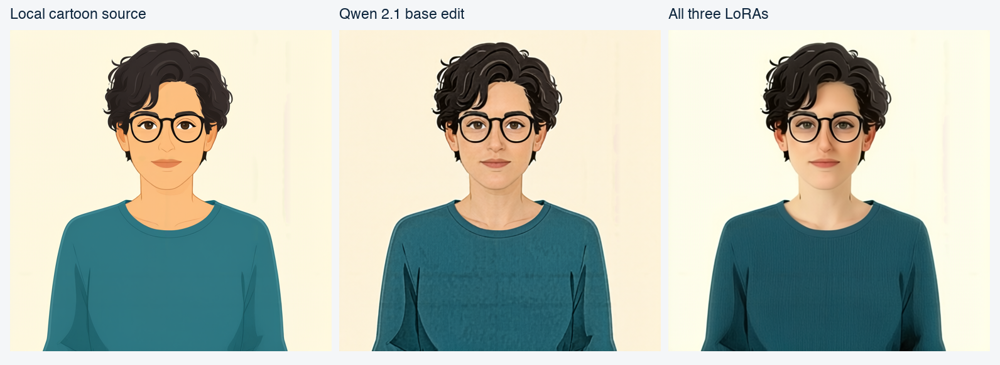

# Results from the local trial

Test machine: Apple M5 Pro, 48 GiB unified memory. These are individual 512-pixel trials, not a benchmark or a performance guarantee.

| Trial | Elapsed | Additional swap written during run |
|---|---:|---:|
| Teapot, base | 61.0 s | 0 MiB |
| Teapot, Consistency | 57.9 s | 0 MiB |
| Teapot, three LoRAs | 56.8 s | 466.8 MiB |
| Fictional portrait, base edit | 57.0 s | 0 MiB |
| Fictional portrait, three LoRAs | 59.7 s | 0 MiB |

The initial configuration wrote about 4.35 GiB of additional swap before being stopped. Matching the text encoder precision, disabling the execution cache, reserving memory, and using the documented launch settings made the subsequent trials practical. Existing swap occupancy can remain after a run; it differs from additional swap written during a run.

The Consistency adapter preserved the teapot scene better in this trial. Adding all three adapters also changed background color and style. Adapter strengths are experimental, not universally optimal.

The portrait input is a generated, fictional adult. The edits stayed stylized; this does not establish real-person identity fidelity. No private photographs are included.

The single-image base, Consistency and three-LoRA paths were rendered locally. The new two-image reference workflow is supplied as a structurally checked starting point; it has not received a separate rendered acceptance test. It does not train or remember a person. See [reference editing](reference-editing.md).
