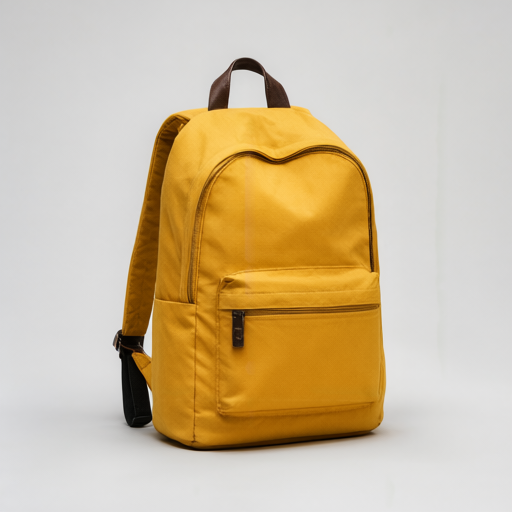
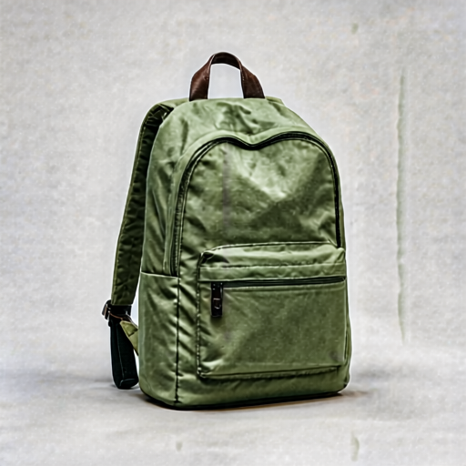
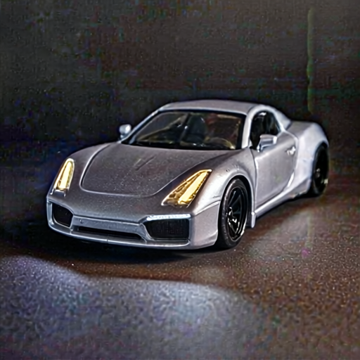
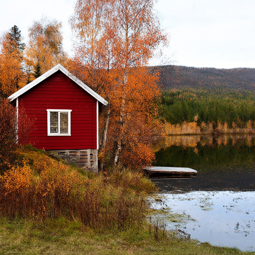

# Synthetic generation and editing samples

All source images on this page were generated from generic text prompts locally with Qwen Image 2.1. No personal photos, personal discussions or personal editing instructions were used. The edited results below are the model's saved outputs, without manual retouching or post-processing.

These are small illustrative trials, not a benchmark. A requested color change can work while other details drift. The winter edit failed in both tested configurations; it is retained to show the current limitations.

## 1. Backpack: yellow to green — partial success

| Generated source | Edited with Consistency |
|---|---|
|  |  |

**Instruction:** Change only the yellow canvas fabric of the backpack to deep forest green. Preserve the brown leather straps, zippers, stitching, shape, camera angle, shadows and pale gray background unchanged.

**Observed:** The fabric became green and the main silhouette stayed recognizable. Wrinkles, texture and background changed noticeably, despite the preservation instruction. This is not a pixel-preserving recolor.

## 2. Toy-car headlights: white to amber — partial success

| Generated source | Edited with Consistency |
|---|---|
|  |  |

**Instruction:** Change only the two illuminated white LED strips inside the front headlights to amber orange. Preserve the headlight shapes, silver paint, wheels, reflections, tabletop, camera angle and background unchanged.

**Observed:** The two headlight strips became warm yellow/amber. The horizontal bumper strip stayed white. The car's shape stayed close, but grain, contrast and reflections changed. This uses a generated toy car, not a private vehicle photograph.

## 3. Cabin: autumn to winter — failed request

| Generated autumn source | Base-model winter attempt |
|---|---|
|  |  |

**Instruction:** Change the season from autumn to winter: cover the ground, dock and tree branches with fresh white snow. Preserve the red cabin, lake, composition, camera angle and distant hills. Keep the lake water visible.

**Observed:** The model retained the autumn scene and changed colors/texture, without producing the requested winter snow. A first attempt with Consistency also failed. The base retry used the same prompt, seed and sampler settings; it did not solve the request. These runs do not establish why it failed or that one adapter is better overall.

## Reproduce or adapt

- All sources are 512 × 512, generated with the base model. Backpack seed: **101**; cabin: **202**; toy car: **303**. Each edit uses its source's seed.
- All runs: **25 steps, CFG 1, Euler, simple scheduler, denoise 1.0**, BF16 model/text encoder and tiled VAE decode.
- Backpack and toy-car edits use **Consistency strength 1.0**. The cabin gallery shows a base-model retry and the first Consistency attempt.
- [samples.json](../examples/samples.json) records full generation/edit prompts, file checksums, API recipe paths and measured elapsed time/additional swap. These are synthetic demonstration prompts only.
- The installer copies the PNG examples to the local ComfyUI input folder. For an existing installation, copy the desired source PNG there yourself or upload it through **Load Image**.
- For the visual editor, open `base-workflow.json` or `consistency-workflow.json`, select the source image and paste its edit instruction. For the base cabin retry, use the base workflow.
- Matching [API recipes](../examples/recipes) are for ComfyUI's programmatic prompt endpoint, not visual workflow imports. Source-generation recipes have no reference-image input; edit recipes reference only the supplied synthetic source filenames.

The first generation wrote about 310 MiB of additional system swap. The subsequent six runs recorded none during their sampling intervals. Timing and swap are machine-specific and system-wide; they are not a promise for other workloads. Saving a seed and prompt improves reproducibility but does not guarantee identical results across software, model or hardware changes.
