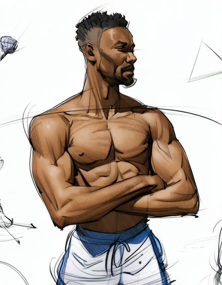
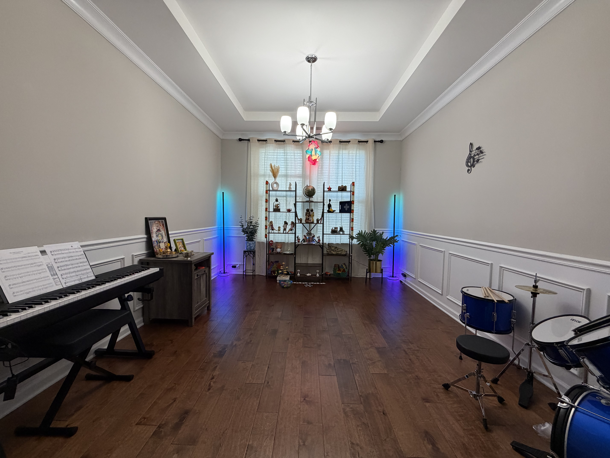
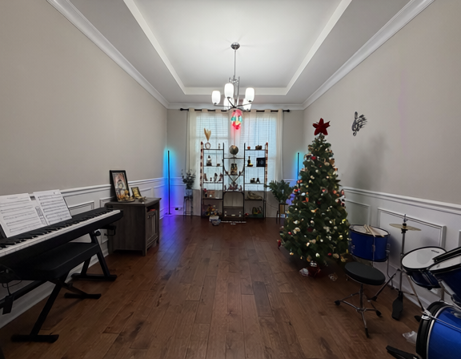

# User-supplied editing examples

The user explicitly selected these four images for inclusion in this repository. Images whose supplied filenames began with `qwen` are the edited/generated outputs; the other two are the sources. These are separate from the [synthetic test gallery](samples.md).

Repository copies have embedded metadata removed and orientation normalized. No visual retouching or resizing was applied. Original files are unchanged. Exact prompts, seed, adapter strengths and sampling settings were not supplied for these examples and are not inferred from the filenames. Personal prompts and discussions are excluded.

## Sketch colorization

| Original reference sketch | Qwen edited output |
|---|---|
|  |  |

The result adds skin tones, dark hair and blue-and-white clothing while broadly retaining the pose and composition. It also changes some linework and shading. The reference sketch was user supplied; its original artist/license was not recorded.

## Add a Christmas tree to a room

| Original room photograph | Qwen edited output |
|---|---|
|  |  |

The result adds a decorated tree with a red star near the right wall. The room layout and instruments remain recognizable, with some detail drift. The edited output is lower resolution than the source; the gallery preserves both supplied sizes.

These are visual examples, not controlled benchmarks or complete reproduction recipes. File dimensions and checksums are recorded in [user-samples.json](../examples/user-samples.json). For runnable synthetic recipes with recorded prompts/settings, use the [synthetic gallery](samples.md). See [third-party terms](../THIRD_PARTY.md) for the scope of the repository license.
